# Entra ID Identity Lifecycle Lab

Identity and access management in **Microsoft Entra ID** for a fictional company, **Fjellheim Logistikk AS**: the full **Joiner–Mover–Leaver (JML)** lifecycle, a **privilege creep** case, a **privilege escalation** incident, and **PowerShell automation with Microsoft Graph** that removes the manual errors found in the lab.

> **Lab only.** Fjellheim Logistikk AS, its users and all data are fictional. Everything runs in my own test tenant. IP addresses and passwords are hidden in the screenshots, and **red boxes** mark the key evidence in each one.

## Key results

- **Joiner, Mover and Leaver** done by hand in the portal, then automated with **Microsoft Graph PowerShell**
- **Privilege creep** reproduced: a promoted user kept his old access for **9 minutes** before it was found and removed. The automated mover script leaves **no window at all**
- **Privilege escalation** to the security team's group detected in the audit logs and contained in **13 minutes** (remove access → revoke sessions → disable account)
- **Leavers are disabled, not deleted**, so their audit history stays available for investigation
- **Detection script** finds additions to privileged groups in the audit logs and separates real alerts from **benign positives** using the user's role
- **Security Defaults blocked device code sign-in** (`AADSTS530035`) during the lab, a common phishing technique

## Environment

| Item | Value |
|------|-------|
| Platform | Microsoft Entra ID (free tier, Security Defaults on) |
| Company | Fjellheim Logistikk AS (fictional logistics company, Oslo) |
| Access model | Role-based access control (RBAC): one role, one security group |
| Automation | PowerShell 7 + Microsoft Graph PowerShell SDK |

### Roles and groups

| Role | Department | Security group |
|------|------------|----------------|
| Lagertekniker (warehouse technician) | Operations | `SG-Ops-Technician` |
| Driftsleder (operations manager) | Operations | `SG-Ops-Manager` |
| Administrasjonskonsulent | Administration | `SG-Admin-Staff` |
| Regnskapsfører (accountant) | Finance | `SG-Finance` |
| IT-konsulent | IT | `SG-IT-HelpDesk` |
| Sikkerhetsanalytiker (security analyst) | IT | `SG-IT-Security` (**privileged**) |

The same mapping is stored in [`automation/config/role-groups.json`](automation/config/role-groups.json), so access rules are defined in one place.

### Baseline users

| User | Role | Group |
|------|------|-------|
| Lars Haugen | Lagertekniker | SG-Ops-Technician |
| Ingrid Solberg | Administrasjonskonsulent | SG-Admin-Staff |
| Ahmed Karimi | Regnskapsfører | SG-Finance |
| Emma Berg | IT-konsulent | SG-IT-HelpDesk |
| Jonas Nilsen | Sikkerhetsanalytiker | SG-IT-Security |
| Test User | Test account | none |

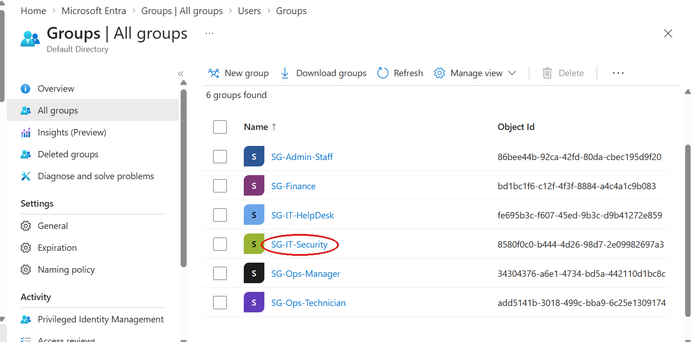

## Identity lifecycle

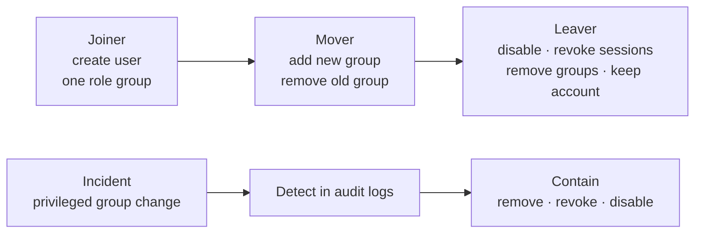

## Joiner: onboarding with least privilege

**Scenario:** Sofie Andersen starts as a warehouse technician.

1. Created the user with job title and department
2. Added her to `SG-Ops-Technician` only
3. Verified the membership and the audit trail

| Time | Activity | Meaning |
|------|----------|---------|
| 21:22 | Add user | Account created |
| 21:22 | Update PasswordProfile | Initial password set |
| 21:22 | Add member to group | Added to SG-Ops-Technician |

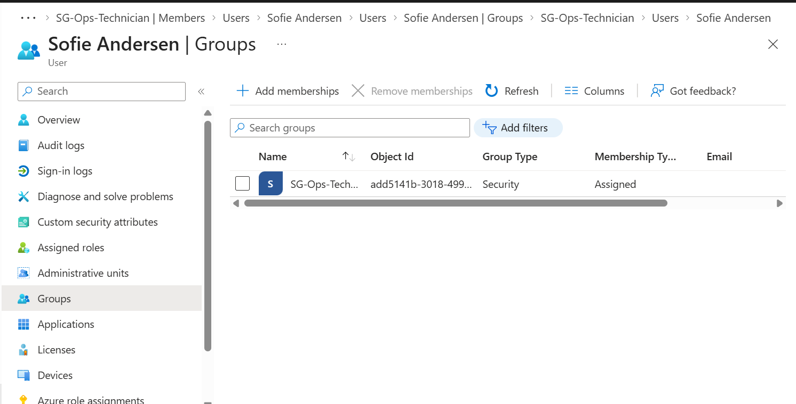
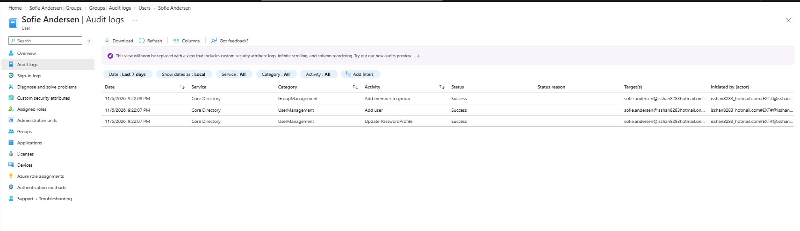

**Why it matters:** access given on day one tends to stay. Starting with exactly one role group keeps the attack surface small from the start.

## Mover: reproducing privilege creep

**Scenario:** Lars Haugen is promoted from warehouse technician to operations manager. IT adds the new group, but forgets to remove the old one.

| Time | Activity | State |
|------|----------|-------|
| 22:03 | Add member to group (SG-Ops-Manager) | Two role groups: **privilege creep** |
| 22:05 | Update user (job title → Driftsleder) | Title changed, old access still there |
| 22:12 | Remove member from group (SG-Ops-Technician) | Remediated |

**Exposure window: 9 minutes.** In a real organization this usually lasts until the next access review, often months.

| Before the fix | After the fix |
|----------------|---------------|
| 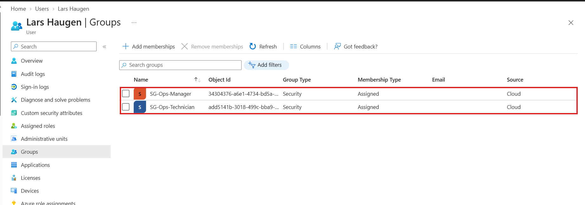 | 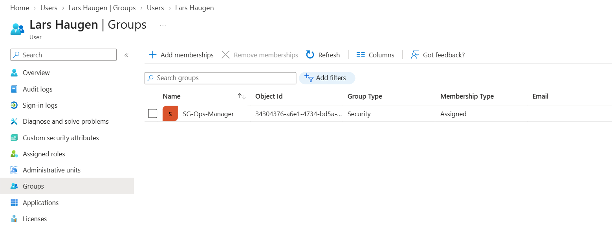 |

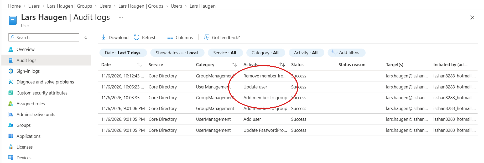

**Why it matters:** role changes are the most common source of privilege creep. Every forgotten group is access an attacker can use for lateral movement if the account is compromised.

## Leaver: secure offboarding

**Scenario:** Ahmed Karimi leaves the company.

| Time | Activity | Purpose |
|------|----------|---------|
| 22:48 | Disable account | Blocks new sign-ins |
| 22:49 | Update StsRefreshTokensValidFrom | **Revoke sessions**: kills tokens already issued, so open apps stop working too |
| 22:52 | Remove member from group | Removes all remaining access |

The account was **disabled, not deleted**. Its full history, from creation to offboarding, is still in the audit logs.

| Account disabled | No groups left |
|------------------|----------------|
| 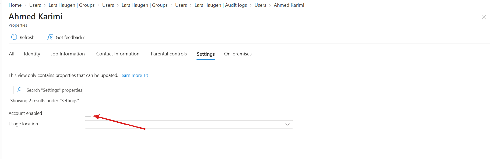 | 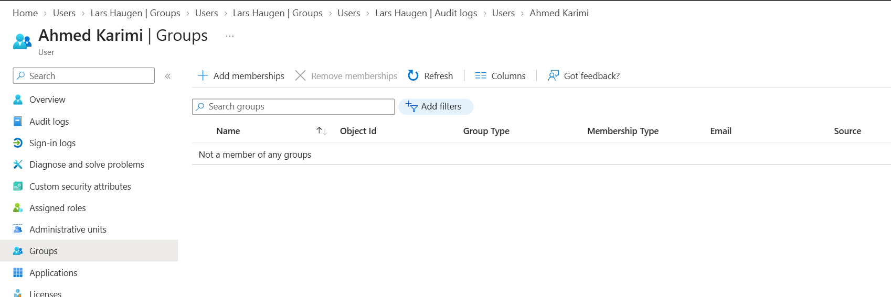 |

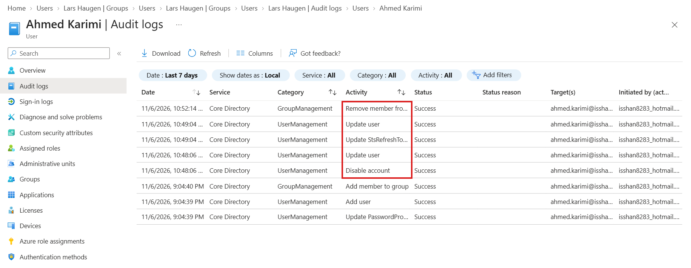

**Why it matters:** disabling an account does not end sessions that are already open. Without revoking sessions, a former employee can keep using an app until the token expires.

## Incident: privilege escalation

**Scenario:** `Test User`, an account with no business reason to be in IT, is added to `SG-IT-Security`, the most privileged group. This simulates an attacker using a compromised admin account to give a foothold account more access.

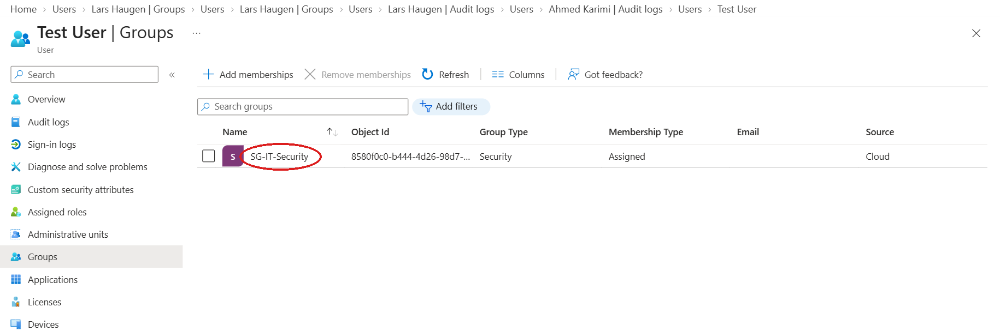

**Investigation** in the audit log entry: *who* made the change (initiated by), *from where* (IP address), *when*, and *to whom*. In a real case the next questions are: is there a change ticket? Was that admin working at that time? Does the user have any reason to be in this group? If not, it is an incident.

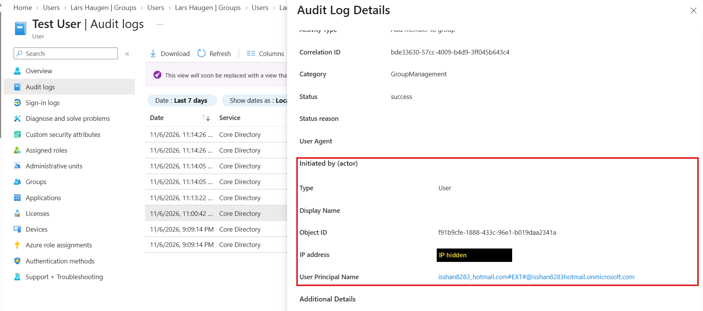

**Containment timeline**

| Time | Activity | Step |
|------|----------|------|
| 23:00 | Add member to group (SG-IT-Security) | Escalation |
| 23:13 | Remove member from group | Privileged access removed |
| 23:14 | Update StsRefreshTokensValidFrom | Sessions revoked |
| 23:21 | Disable account | Account disabled |

**Dwell time: 13 minutes** from escalation to removal of access.

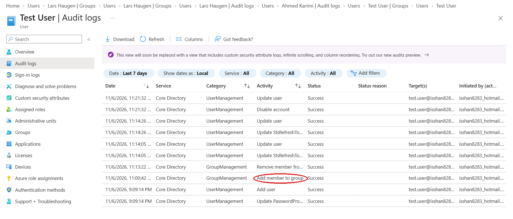

## Automation with Microsoft Graph PowerShell

The manual lab showed where people make mistakes. The scripts in [`automation/`](automation/) make each step repeatable and remove those mistakes.

| Script | What it does |
|--------|--------------|
| [`connect-graph.ps1`](automation/connect-graph.ps1) | Connects with only the permissions the scripts need |
| [`joiner-onboard-user.ps1`](automation/joiner-onboard-user.ps1) | Creates a user and adds the one group that belongs to the role. Temporary password must be changed at first sign-in |
| [`mover-change-role.ps1`](automation/mover-change-role.ps1) | Adds the new role group, **removes every other role group**, and updates the job title |
| [`leaver-offboard-user.ps1`](automation/leaver-offboard-user.ps1) | Disables the account, revokes sessions and removes all groups. Asks for confirmation first |
| [`incident-contain-user.ps1`](automation/incident-contain-user.ps1) | Removes privileged access, revokes sessions and disables the account in one step |
| [`detect-privileged-group-changes.ps1`](automation/detect-privileged-group-changes.ps1) | Reads the audit logs, alerts on additions to a privileged group, and marks each alert `OPEN`, `EXPECTED` or `CLOSED` |

All scripts that change data support `-WhatIf`, so a change can be previewed before it is made.

**Joiner:** one role, one group, verified

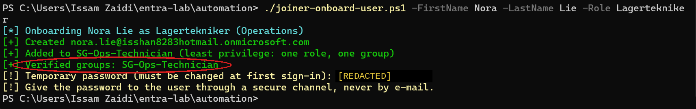

**Mover:** the old group is removed in the same run. The 9-minute privilege creep window from the manual test does not exist here

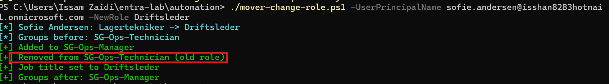

**Leaver:** confirmation, then disable, revoke and remove

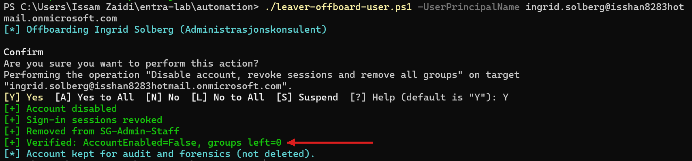

### Detection without a SIEM

`detect-privileged-group-changes.ps1` reads the directory audit logs through Microsoft Graph, which works on the free Entra ID tier, and alerts on every addition to a privileged group. It is the same logic as a Microsoft Sentinel analytics rule.

The first version flagged **Jonas Nilsen**, the company's security analyst, as an open alert. The rule was right, but he belongs in that group: a **benign positive**. To cut that noise, every alert is now **enriched with the user's job title** and checked against the same role map the joiner and mover scripts use:

| Status | Meaning | Action |
|--------|---------|--------|
| `OPEN` | Still a member, and the role does not need the group | Investigate, then contain |
| `EXPECTED` | Still a member, and the role map gives this group | Benign positive, confirm approval |
| `CLOSED` | No longer a member | Already handled |

Run against the lab, it found both additions to `SG-IT-Security`: Jonas as `EXPECTED`, and the incident's test account as `CLOSED`, since it had been contained.

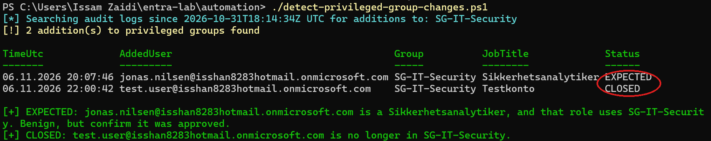

One role map now drives both **access** (who gets which group) and **detection** (which memberships are unexpected).

### Least-privilege permissions

| Scope | Used for |
|-------|----------|
| `User.ReadWrite.All` | Create users, change job titles, disable accounts |
| `Group.ReadWrite.All` | Add and remove group members |
| `User.RevokeSessions.All` | Revoke sessions for leavers and incidents |
| `Domain.Read.All` | Find the tenant's default domain for new usernames |
| `AuditLog.Read.All` | Read audit logs for detection |

### Running the scripts

Prerequisites: PowerShell 7 and the Microsoft Graph PowerShell SDK (`Install-Module Microsoft.Graph -Scope CurrentUser`).

```powershell
cd automation
./connect-graph.ps1 -TenantId <tenant>.onmicrosoft.com

./joiner-onboard-user.ps1 -FirstName Nora -LastName Lie -Role Lagertekniker
./mover-change-role.ps1 -UserPrincipalName sofie.andersen@<tenant>.onmicrosoft.com -NewRole Driftsleder
./leaver-offboard-user.ps1 -UserPrincipalName ingrid.solberg@<tenant>.onmicrosoft.com
./detect-privileged-group-changes.ps1
```

## Security decisions

**Device code sign-in was blocked, and that is a good thing.** The first attempt to connect used device code flow. Security Defaults blocked it with `AADSTS530035`, because device code flow is widely abused in phishing: the attacker starts the flow and tricks the victim into entering the code. The scripts use interactive sign-in instead.

**Personal Microsoft accounts need an explicit tenant.** The admin account is a personal Microsoft account. Without `-TenantId`, Graph signed in to the consumer tenant (`9188040d-…`) instead of the lab directory. The connect script therefore requires the tenant.

**No Conditional Access in this lab.** Conditional Access needs Entra ID P1 or P2. The available trial required payment details, and using Conditional Access means turning Security Defaults off. I kept Security Defaults, which already enforce MFA and block risky sign-in flows at no cost. In a production tenant I would replace them with Conditional Access policies, starting in report-only mode and with an excluded **break-glass account**, so a policy mistake cannot lock out every administrator.

## Lessons learned

- **Process gaps create risk, not just attackers.** The privilege creep in this lab came from a forgotten step, not an exploit.
- **Automate the steps people forget.** The manual mover left old access behind; the script cannot.
- **Disable is not enough.** Revoking sessions is what actually ends access that is already in use.
- **Keep the evidence.** Disabled accounts and their audit logs are what makes an investigation possible later.
- **Audit logs answer who, what, when and from where**, but someone has to look. Detection has to be automated to be reliable.
- **A correct alert is not always a threat.** Context such as the user's role turns a noisy rule into one an analyst can act on.

## Future improvements

- Conditional Access with Entra ID P1: MFA for privileged groups, block legacy authentication, block device code flow, with a break-glass account excluded
- Send Entra ID audit logs to Microsoft Sentinel and turn the detection script into a scheduled analytics rule (see my [Azure Sentinel SOC Lab](https://github.com/Samosamo200/azure-sentinel-soc-lab))
- Privileged Identity Management (PIM) for just-in-time membership of `SG-IT-Security`
- Access reviews to catch privilege creep that was not prevented
- Lifecycle workflows for joiner and leaver tasks

## Skills

`Microsoft Entra ID` · `IAM` · `RBAC` · `Least Privilege` · `Joiner-Mover-Leaver` · `Audit Logs` · `Incident Response` · `PowerShell` · `Microsoft Graph` · `Security Defaults`

---

Built by **Issam Zaidi** as part of my bachelor's in cybersecurity at Høyskolen Kristiania.
